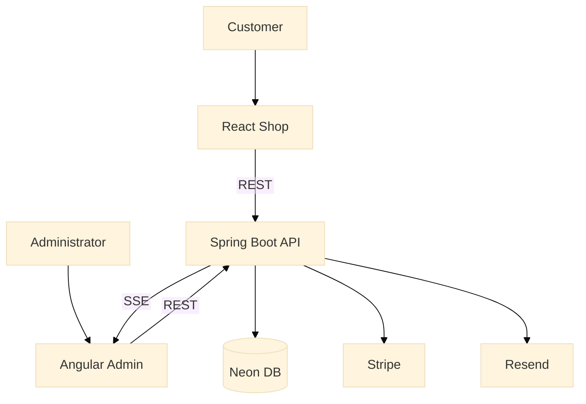

# SmartCommerce

**SmartCommerce** is a full-stack, multi-business e-commerce platform built as a Java development capstone project and
continuing as an active portfolio project. It connects a **React customer shop** and an **Angular administration app**
to a shared **Spring Boot REST API** and **PostgreSQL** database.

## Live Demo

- **Customer Shop (React):** https://smartcommerce-shop.onrender.com
- **Admin Dashboard (Angular):** https://smartcommerce-admin-c1k4.onrender.com
- **Backend API (Spring Boot):** https://smartcommerce-v233.onrender.com
- **Demo video:** _Link coming soon (video recorded; not yet published)._

> The applications use free-tier hosting. The first request after inactivity may take longer to respond.
>
> **Demo security note:** Admin authentication and backend authorization for administrative operations are not yet
> implemented. The admin interface and related write endpoints should be treated as a demonstration environment, not a
> production-secure system.

## Features Implemented

### React Customer Shop

- Browse products across multiple businesses/storefronts
- View product details and manage a shopping cart
- Register, verify email addresses through Resend, log in and log out
- Place orders and complete test-mode payments with Stripe
- Receive order confirmation emails through Resend

### Angular Admin

- Select a business and manage its products
- Manage inventory and view stock information
- View orders and order details

### Backend and Platform

- Business-scoped REST APIs for products, inventory and orders
- Inventory deduction during order placement
- Real-time inventory updates using Server-Sent Events (SSE)
- PostgreSQL persistence, automated tests and CI/CD
- Deployment using Render and Neon PostgreSQL

## Architecture



Both frontends are deployed on Render and communicate with the shared backend. The backend manages business data,
authentication, orders and inventory.

## Technology Stack

| Layer                  | Technology                                     |
|------------------------|------------------------------------------------|
| Backend                | Java, Spring Boot, Maven, Spring Security      |
| Customer frontend      | React, TypeScript, Vite                        |
| Admin frontend         | Angular, TypeScript                            |
| Database               | PostgreSQL (local Docker / Neon deployment)    |
| Payments               | Stripe (test mode)                             |
| Transactional email    | Resend (verification and order confirmation)   |
| Deployment             | Render, Neon                                   |
| Quality and automation | GitHub Actions, JUnit, JaCoCo, SonarQube Cloud |

## Screenshots

Screenshots will be added for the multi-store landing page, product catalogue, cart/checkout and Angular Admin.

<!-- Example once an image is committed:  -->

## Repository Structure

- `backend/` — Spring Boot backend
- `frontend/angular-app/` — Angular frontend
- `frontend/react-app/` — React frontend
- `docs/` — Project and architecture documentation

## Local PostgreSQL

SmartCommerce uses PostgreSQL for local development.

### Prerequisite

Set the `POSTGRES_PASSWORD` environment variable on your local machine.

### Start PostgreSQL

From the project root:

```bash
docker compose up -d postgres
```

_Application startup and local environment configuration should be checked against the current project files before
adding complete run instructions._

## Deployment

SmartCommerce is deployed using Render and Neon PostgreSQL.

### Production Environment

- The backend connects to Neon PostgreSQL using environment variables configured in Render.
- Production secrets are not committed to the repository.
- The React shop uses `VITE_API_BASE_URL` and deployment-specific business configuration.
- The Angular Admin uses Angular environment configuration for the production API URL.
- Deployments are triggered automatically from the `main` branch.

## Code Quality

SmartCommerce uses SonarQube Cloud for automated backend code quality analysis.

The backend CI pipeline runs automatically on pull requests targeting `main` and on pushes to `main`. It:

- builds the Spring Boot backend with Maven
- runs the backend tests
- generates JaCoCo test coverage
- runs SonarQube Cloud analysis
- reports the Quality Gate result on GitHub pull requests

The Sonar authentication token is stored securely as the `SONAR_TOKEN` GitHub Actions secret and is not committed to the
repository.

## Roadmap

SmartCommerce is actively developed. Planned improvements include:

- Admin authentication, roles and authorization for administrative APIs
- Stripe Connect for payments to individual businesses
- AI-assisted product descriptions
- Additional business management and user experience improvements

## Project Status

**Capstone presentation completed (October 2026) — ongoing development.** This repository demonstrates the current
implementation; roadmap items are not yet available.

## Author

**Mohammad Aziz**

- [GitHub](https://github.com/mohammadAziz-dev)
- [LinkedIn](https://www.linkedin.com/in/mohammad-aziz-dev/)
- Portfolio: https://mohammadaziz.dev